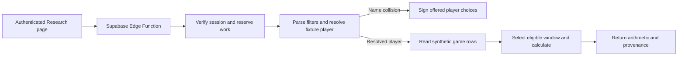

# AI Analytics Assistant

The authenticated page lives at `/research/analytics`, under Research. The Edge Function is `ai-analytics-assistant`. The review branch starts at security PR #1 commit `1e34bf42d6789c779704c6e824911ac9226c7526`.

## Try the synthetic demo

Run these commands from the repository root with Node 22 and Deno 2.5.6. The build uses a fake publishable key and a loopback URL.

```sh
npm ci --ignore-scripts --no-audit --no-fund
VITE_SUPABASE_URL=http://127.0.0.1:47961 \
VITE_SUPABASE_PUBLISHABLE_KEY=sb_publishable_offline_fixture npm run build
deno run --frozen --allow-net=127.0.0.1:47961 --allow-read=dist ops/analytics-demo.ts
```

1. Open [AI Analytics Assistant](http://127.0.0.1:47961/research/analytics). Select **Sign in** and use `analyst@example.invalid` and `demo-only-password`. These credentials belong to the loopback stub.
2. Select **Average points**. Avery Stone's values are 10, 20, 30, 20 and 15. Their sum is 95, so the average is **95 ÷ 5 = 19**.
3. Select **What about rebounds?**. The assistant keeps the player, last-five window and cutoff. The rebound sum is 30, so the average is **30 ÷ 5 = 6**.
4. Select **At least 20 points**. The two 20s and the 30 meet the inclusive threshold, so the result is **3/5**. Ask “How many times did Avery Stone score more than 20 points in the last 5 games?” for **1/5** with two pushes.
5. Select **Ambiguous player**, then **Jordan Reed · NYK**. The New York fixture yields **20 ÷ 5 = 4 assists**. Boston is a separate fixture player.
6. Ask “Average points for Casey Lane in the last 5 games” to see an incomplete window with one missing value. Ask through `2026-11-11` to see the stale-source state. To simulate an outage, stop the demo server and rerun it with `--fail-source` after the script path, then sign in again in a fresh tab session.

The demo serves the built app and uses the same assistant handler, calculation engine and fixtures as the Edge Function. It binds to loopback and stubs session verification. Its content security policy restricts requests to the local origin. The Edge integration tests separately exercise actual `requireAuth` wiring against a fake Supabase Auth transport. The loopback server and credentials are for development only.

## Supported questions

| Capability | Example |
| --- | --- |
| NBA points, rebounds, assists and three-pointers made | “Average 3PM for Avery Stone in the last 10 games” |
| Counts with ≥, >, ≤, < or = | “How many times did Avery Stone record at most 5 rebounds in the last 5 games?” |
| Stable player identity | “Average assists for Jordan Reed on BOS in the last 5 games” |
| ISO cutoff and Eastern calendar words | “Average points for Avery Stone in the last 5 games through 2026-11-05” |
| Follow-up metric, window, threshold or date | “What about rebounds?”, “What about the last 10 games?”, “What about over 20?” or “What about yesterday?” |

A full question requires a fixture player, a supported statistic and the last 5 or 10 appearances. The parser supports a bounded set of English phrasings and rejects other leagues, season scopes, live questions, arbitrary queries and wagering requests. A date-free full question uses the snapshot cutoff. “Today” and “yesterday” use the America/New_York calendar at request time and may exceed the frozen coverage date.

## From question to evidence



- `contract.ts`, `questions.ts` and `answer.ts` validate the bounded request, resolve the player and handle follow-ups or clarification. The canonical filters contain league, player ID, metric, requested window, cutoff and operation.
- `source.ts` uses the existing `public.player_recent_games` column shape. `fixtures.ts` is the registered source. The `supabaseSource.ts` adapter is disconnected from the Edge entrypoint and covered by offline mock tests. Its query uses the verified user's bearer token and a publishable key, with sport, player ID and cutoff filters, stable order, bounded pagination and exact counts. It requires independent eligibility and snapshot provenance. No schema migration is needed for fixtures.
- `calculate.ts` deduplicates by sport, player and game, excludes scheduled games and DNPs, sorts by date then lexically descending game ID and selects the window before checking metric values. An unresolved eligibility inside the window, conflicting duplicates, a missing stat or fewer than N eligible appearances suppresses the full calculation. Null remains unknown. Older rows cannot replace a selected missing value.
- The response carries the selected IDs, dates and stat values. An average includes the integer sum, denominator and quotient. The UI displays up to two decimal places. A threshold result includes the comparator, threshold, hit count, denominator, equality count and strict-comparator pushes. These are historical counts on fictional data.
- Dataset revision `nba-fixtures-v1` covers through `2026-11-10` Eastern. The snapshot time, latest eligible game date and computation timestamp are distinct fields. Provider fetch time is unavailable for fixtures. A requested date after coverage produces `STALE_SOURCE` without a statistic.

## Authentication and operations

- The Edge Function verifies the bearer session through Supabase Auth and requires a user ID. Publishable keys and service-only requests cannot act as an assistant user. Browser requests use the existing Supabase client. If configured in a nonproduction Edge environment, set `ANALYTICS_ALLOWED_ORIGINS` to a comma-separated list of exact trusted app origins. The default allows localhost and 127.0.0.1 on port 8080.
- Optionally configure a dedicated high-entropy URL-safe `ANALYTICS_CONTEXT_SECRET` with at least 32 characters on the server. When omitted, signing uses the existing server-side Supabase secret through a domain-separated HMAC. Follow-up state expires after 10 minutes and is signed for the verified user. State includes validated filters or offered IDs and excludes question text and result rows. The UI holds it in memory and clears it on reset, logout, account change or sport change.
- The body is limited to 4 KiB and questions to 240 characters. The request and shared calculation each have a four-second deadline. Per Edge isolate, the handler permits 16 simultaneous authentication calls, 16 calculations globally, two calculations per user and 30 new requests per user per 60 seconds. Identical retries share a result for 60 seconds, up to 512 entries per isolate. Reusing an ID with different input returns 409. Cancellation detaches the browser while bounded shared work can finish for an identical retry. These in-memory controls reset on isolate replacement and provide no cross-isolate quota guarantee.
- Filter structured `analytics_assistant` logs by correlation ID for triage. Records contain outcome code, elapsed milliseconds, replay status and data mode. Logs exclude questions, calculated values, account IDs, tokens and raw upstream errors. The UI shows safe states for sign-in, unsupported questions, missing data, source outages, timeouts and throttling. The feature has no chat history or telemetry table and calls no LLM.

## Verify the branch

```sh
npm test
npx --no-install tsc -p tsconfig.app.json --noEmit
npx --no-install tsc -p tsconfig.node.json --noEmit
deno check --frozen supabase/functions/*/index.ts ops/analytics-demo.ts
deno test --frozen --import-map=ops/tests/deno-imports.json --allow-env supabase/functions/
deno test --frozen supabase/functions/_shared/analyticsAssistant/golden_test.ts
```

The local suite passed 32 Vitest tests and 187 Deno tests, including 46 versioned synthetic goldens and the existing billing and security tests. The Vite build and both TypeScript checks passed. `.github/workflows/analytics-assistant-ci.yml` repeats the build and suites with Node 22 and Deno 2.5.6. It has no schedule, deploy step, provider credentials or ingestion step.

The first clean GitHub runner received different bytes from esm.sh for the same tslib URL and Deno rejected them. The test-only import map resolves that one module to tslib 2.8.1 from the existing npm lockfile, installed by `npm ci`. Edge type checking still uses the frozen Deno lockfile and deployed imports are unaffected.

For a reproducible Chromium check, run these commands with the corresponding loopback server mode running. The second run requires restarting the server with `--fail-source`.

```sh
playwright-cli -s=betstreaks-analytics open http://127.0.0.1:47961/research/analytics
playwright-cli -s=betstreaks-analytics run-code --filename=ops/tests/analytics-browser.js
playwright-cli -s=betstreaks-analytics goto 'http://127.0.0.1:47961/research/analytics#fail-source'
playwright-cli -s=betstreaks-analytics run-code --filename=ops/tests/analytics-browser.js
playwright-cli -s=betstreaks-analytics close
```

The read-only npm advisory scan found 28 baseline findings. Critical Vitest and Tinypool findings are in test tooling. High findings also include frontend runtime packages and build tooling. The branch keeps the lockfile and adds no packages. The assistant bounds inputs before parsing and uses no Zod collection validation. Keep development and test services local. Track dependency upgrades separately from the fixture branch.

## Real-data activation gates

The Edge entrypoint registers fixtures directly. Activating another source requires a reviewed code change. Before that change, the owner must provide all of the following.

1. Written rights for the exact account and feed covering commercial and betting-adjacent analysis, caching and retention, display of game-level evidence and derivatives, attribution and portfolio use. Confirm model-processing rights separately before introducing an LLM. The existing `nba_api` client grants no feed rights. Public NBA terms restrict use and the SportsDataIO account and contract determine applicable data rights. [NBA Terms of Use, section 9](https://www.nba.com/termsofuse) · [SportsDataIO data rights and licensing](https://sportsdata.io/help/data-rights-and-licensing-questions)
2. One owner-approved authoritative NBA refresh runner. Verify current schedules and feed coverage from metadata, resolve competing runners through the security runbook and rehearse with licensed staging data after approval. The assistant never calls ingestion.
3. Verified stable player and game IDs, dates and sport, actual metric coverage, DNP/finality rules, corrections, snapshot completeness, attributable provider and source timestamps, and a measurable freshness target. `player_recent_games.updated_at` is a local row timestamp. The table alone cannot attest upstream time, completeness or eligibility.
4. A consistent verified read revision, approved display policy and authenticated RLS validation. Exact counts can identify many incomplete reads. A versioned snapshot or equivalent consistency guarantee is required to detect same-count changes while paging. Add a minimal provenance manifest only if an existing source cannot supply this evidence.
5. Owner sign-off on [the security release runbook](../ops/SECURITY_RELEASE_RUNBOOK.md), staged verification and a separate activation review. Add shared atomic budget enforcement before introducing billable provider traffic or claiming a global limit.
